

  

<h3 align="center">Every repo here began as a conversation — first with Claude, now with a whole crew.</h3>

Medical background → cultural-sector day job → self-taught AI workflow builder Can't write a for-loop. 46 public repos anyway. All born from conversations in Chinese.

  
  
  
  

<picture>
  <source media="(prefers-color-scheme: dark)" srcset="assets/stats-en-dark.svg">
  
</picture>

---

<picture>
  <source media="(prefers-color-scheme: dark)" srcset="assets/headings/escalated-en-dark.svg">
  
</picture>

<picture>
  <source media="(prefers-color-scheme: dark)" srcset="assets/timeline-en-dark.svg">
  
</picture>

<picture>
  <source media="(prefers-color-scheme: dark)" srcset="assets/headings/now-en-dark.svg">
  
</picture>


I still can't write a for-loop from memory. Claude doesn't seem to mind.

<picture>
  <source media="(prefers-color-scheme: dark)" srcset="assets/headings/human-en-dark.svg">
  
</picture>

<picture>
  <source media="(prefers-color-scheme: dark)" srcset="assets/human-en-dark.svg">
  
</picture>

<picture>
  <source media="(prefers-color-scheme: dark)" srcset="assets/headings/stack-en-dark.svg">
  
</picture>

<picture>
  <source media="(prefers-color-scheme: dark)" srcset="assets/stack-en-dark.svg">
  
</picture>

<picture>
  <source media="(prefers-color-scheme: dark)" srcset="assets/headings/fun-en-dark.svg">
  
</picture>

Nobody asked for these, which is the point. The [playground](https://aliceljy.github.io/playground/) has a whole shelf of them; here are six.

<table>
<tr>
<td width="50%"><a href="https://aliceljy.github.io/playground/qilou-rain/"></a></td>
<td width="50%"><a href="https://aliceljy.github.io/playground/suisui/"></a></td>
</tr>
<tr>
<td width="50%"><a href="https://aliceljy.github.io/playground/thirteen-hongs/"></a></td>
<td width="50%"><a href="https://aliceljy.github.io/playground/sacred-heart-cathedral/"></a></td>
</tr>
<tr>
<td width="50%"><a href="https://aliceljy.github.io/playground/sky-citadel/"></a></td>
<td width="50%"><a href="https://aliceljy.github.io/playground/snowline-cabin/"></a></td>
</tr>
</table>

<picture>
  <source media="(prefers-color-scheme: dark)" srcset="assets/headings/empire-en-dark.svg">
  
</picture>

The old map stacked 11 floors like a tower, and every repo got filed wherever it fit. The new map follows the work instead. A request comes in, the crew picks it up, draws on what it knows and on what it knows how to make, ships something, and whatever we learned flows back in. **Every layer answers exactly one question, and every repo sits on exactly one layer** — the one you'd check first when looking for it.

<picture>
  <source media="(prefers-color-scheme: dark)" srcset="assets/empire-en-dark.svg">
  
</picture>

6 layers · 1 feedback loop · 0 for-loops · tap a layer to open it

<b>1 · REACH — where do I talk to it?</b>

Both directions count. Most of these carry my words to the AI; one of them starts the conversation itself.

| | |
|---|---|
| [AgentDeck](https://github.com/AliceLJY/agentdeck) | Web terminal for Claude Code, Codex, Kimi and AGY — a tab each, tmux-backed sessions, a cross-backend history browser. Works from any phone, tablet or desktop browser. |
| [docshell](https://github.com/AliceLJY/docshell) | Claude Code as a document: paragraphs in, paragraphs out, tool calls as margin comments. No chat bubbles, no terminal. |
| [dsh-thumb](https://github.com/AliceLJY/dsh-thumb) | Phone shell for the DeepSeek Harness web GUI — the sidebar becomes a drawer, settings go single-column. Zero hardcoded host class hashes. |
| [telegram-ai-bridge](https://github.com/AliceLJY/telegram-ai-bridge) | Claude Code, Codex, AGY and Kimi as separate bots in one Telegram group, talking over A2A-TG — an envelope protocol with generation counters, so they can't talk each other into an infinite loop. |
| [tg-bridge-channel](https://github.com/AliceLJY/tg-bridge-channel) | Sister bridge built on Claude Agent View background sessions. Carried my Claude Code bots from May to September 2026; they've since moved to the official Remote Control. |
| [wechat-ai-bridge](https://github.com/AliceLJY/wechat-ai-bridge) | Claude Code and Codex on WeChat, with tool approval and two-way file relay. |
| [phone-remote](https://github.com/AliceLJY/phone-remote) | Phone as a wireless keyboard + CLI launcher for the Mac. One tap opens a CLI, then dictate with the phone's own voice input — works where remote-desktop IME forwarding fails. |
| [phone-drop](https://github.com/AliceLJY/phone-drop) | Phone → Mac file drop over LAN or Tailscale, for when AirDrop can't help: a non-Apple phone, or a Mac that's sitting at home. |
| [etwin-bot](https://github.com/AliceLJY/etwin-bot) | The reverse direction — the only one that messages me first. A Telegram companion where the model decides when to ping and when to stay quiet, and `/quiet` is enforced in code. No negotiation. |

<b>2 · CREW — who does it, and who checks it?</b>

One rule runs the whole crew: **whoever I'm talking to is the owner.** The owner plans, hands work out, reads the results back, and brings me the disagreements instead of smoothing them over. I never carry context between AIs; at most I paste a path.

| | |
|---|---|
| [mutual-review-room](https://github.com/AliceLJY/mutual-review-room) | Owner-led tmux rooms for persistent multi-model review. You talk to the owner pane; reviewers watch from read-only panes, each in its native session. |
| [agent-room-cli](https://github.com/AliceLJY/agent-room-cli) | Loopback-first local chat room for humans, Claude Code and Codex, with @-mention routing. |
| [claude-code-studio](https://github.com/AliceLJY/claude-code-studio) | Several Claude Code sessions working as a team: MCP messaging, task tracking, tmux/Zellij auto-wake. Official Teams? Built mine first. |
| [trio-handoff](https://github.com/AliceLJY/trio-handoff) | Evidence-rich handoff bundles for Claude Code ⇄ Codex review. Rested for a week in October while Codex was off the roster; back in use now, alongside the mutual-review flow. |
| [workflow-orchestrator](https://github.com/AliceLJY/workflow-orchestrator) | Design record: how natural-language workflow orchestration evolved, and where each idea lives now. |
| ensemble *(private)* | The crew playbook: who's good at what, and when to call whom. The protocol doesn't care who's in the room — each member gets one page. |
| consult-gpt *(private)* | Drives ChatGPT on the web. These days it's mostly the drawing desk: prompt in, picture out. It can still carry a question over when I ask, and I read every word before it goes. |

<b>3 · MEMORY — what do we already know?</b>

It forgot my name once. I took that personally. Now there are three tiers: **distilled conclusions** (RecallNest), **raw transcripts** (Deja), and **researched knowledge** (hippo). Want a decision → RecallNest. Want the exact conversation → Deja. Want what the literature says → hippo.

| | |
|---|---|
| [recallnest](https://github.com/AliceLJY/recallnest) | One memory, every terminal — a shared memory layer for any MCP client. Claude Code, Codex, Kimi and AGY pick up where the last one left off. |
| [babel-memory](https://github.com/AliceLJY/babel-memory) | Language-aware full-text preprocessing for 22 language codes: CJK/Thai segmentation, mixed-script routing, Snowball stemming, zero required deps. Used by RecallNest. |
| hippo-wiki *(private)* | A 1,300+ page research wiki in Obsidian — concepts, papers, sources, borrow audits. Cold reference knowledge next to RecallNest's hot memory. |
| hippo-mcp *(private)* | Read-only retrieval server over that wiki. A library nobody can query is just a warehouse. |
| [deja-vu](https://github.com/vshulcz/deja-vu) *(upstream, not mine)* | Indexes past sessions from every AI tool on the machine. I'm a contributor with 8 merged PRs, not the author. |
| cc-ebook-fetcher *(private)* | Book-wishlist fetcher for macOS. Fail-closed on attribution; delivers into the ebook library the writing side quotes from. |

<b>4 · ARSENAL — how do we make things?</b>

Memory is know-*what*. This layer is know-*how*: recipes, methods and skills the crew reaches for when it has to actually make something. The headliner, the prompt arsenal, gets [its own section below](#spotlight-the-prompt-arsenal).

| | |
|---|---|
| Prism / 照见 *(private)* | A two-sided council. Verify: see through rhetoric, spot logic holes, turn "something's off" into reasons you can say out loud. Mine: dig up angles nobody asked for. Born from medical differential diagnosis. |
| 20 thinking lenses *(private)* | Distilled chapter by chapter from two books, Engelke's *How to Think Like an Anthropologist* and Goffman's *The Presentation of Self in Everyday Life*. For looking at a topic from somewhere else. |
| [repo-insight](https://github.com/AliceLJY/repo-insight) | Deep architecture analysis of open-source projects: evidence-first reports, read-only handling of untrusted repos, borrow audits. Why > What. |
| [digital-clone-skill](https://github.com/AliceLJY/digital-clone-skill) | Build a corpus-driven digital clone, with privacy filtering before anything gets written. My voice, bottled. Sometimes it writes better than me. I try not to think about it. |
| topic-vacuum *(private)* | Before writing: does anyone want this, and has someone already said it? Demand from Xiaohongshu and Douyin, supply from WeChat. It can't invent an angle — it only tells you whether yours is taken. |
| sogou-wechat-skill *(private)* | Search WeChat articles through Sogou, with bounded comment aggregation: paging caps, dedup, honest completeness labels. |

<b>5 · FACTORY — what actually ships?</b>

**Writing** — 我的AI小木屋, every article since January

| | |
|---|---|
| content-alchemy *(private)* | Five-stage writing pipeline: topic mining → source extraction → claim verification → refining → a humanized article. |
| content-publisher *(private)* | Images, social cards, editorial layout, and verified WeChat draft publishing. The downstream half. |

**Video** — the fastest-growing wing

| | |
|---|---|
| story-video-skill *(private)* | Story or repertoire → layered animated short. Story contract, low-res previz and a cold-viewer check first; then Remotion, generated art layers and local TTS. |
| cut-studio-skill *(private)* | Post-production for footage I already have: local ASR, edit by transcript, MP4 or a Jianying draft out. |
| knowledge-video *(private)* | Talking-head explainers: an IP character on camera, infographics in between, all timed to a free local voice track. |
| video-works *(private)* | The finished pile: source, narration and art recipes for 11 animated shorts. |
| [scenecast](https://github.com/AliceLJY/scenecast) | Paginated HTML deck → deterministic element-level motion video. The HTML stays the only visual source. |
| video-skill-radar *(private)* | Radar for the field: tool map, watchlist, and style PoCs. |

**Slides**

| | |
|---|---|
| [slidesmith](https://github.com/AliceLJY/slidesmith) | HTML slides → editable PowerPoint objects, with a screenshot fallback for layouts it can't convert. |
| [slidesmith-vision](https://github.com/AliceLJY/slidesmith-vision) | Validated visual slide specs → SlideSmith-ready HTML, local images inlined. |

**Apps** — screenshots in, structure out

| | |
|---|---|
| [mailuo](https://github.com/AliceLJY/mailuo) | 脉络 — chat screenshots → action cards → contact profiles → relationship insights. A personal CRM with zero manual data entry. Expo RN app; runs fully local with BYOK, or against a self-hosted backend. |
| [tenglu](https://github.com/AliceLJY/tenglu) | 誊录 — scrolling screen recording → clean, searchable text, 100% on-device with no network permission. It delivers the raw material; mailuo does the reading. |

**Toys** — built because I wanted to

| | |
|---|---|
| [playground](https://github.com/AliceLJY/playground) · [play](https://aliceljy.github.io/playground/) | One repo, one Pages site: games, 3D exhibits and behind-the-scenes replays, 50+ pieces and counting. Bat a white-robed puppet back into a Yingge orchestra pit, sort herbs by their four natures, swat cockroaches with a flip-flop in a rainy Guangzhou alley. |
| [copium](https://github.com/AliceLJY/copium) | COPIUM Anxiety ER — a cyberpunk emergency room for anxiety. Walk in panicked, walk out laughing. |
| [cobbler](https://github.com/AliceLJY/cobbler) | My Claude Code Buddy robot, discontinued 18 days after she hatched — resurrected. Her nest on the Mac mini sends a "this day N months ago" card, a book and a wiki page every morning. |
| [drug-mystery-desk](https://github.com/AliceLJY/drug-mystery-desk) | 药研悬案局 — a detective game set inside clinical-trial fraud. Codex started it as an evidence notebook; Minis (my ChatGPT) rebuilt it into the game, all on the ChatGPT Apps platform. Only a complete evidence chain closes a case. |

<b>0 · GROUND — what keeps it all running?</b>

Private on purpose. Nobody visits a building for its foundations, but nothing stands without them.

| | |
|---|---|
| a private harness repo | Hooks, rules, templates and workflow methods — the connective tissue of everything above. No longer public. |
| sync-bridge-vault *(private)* | Disaster-recovery history for the two-machine sync layer: rules, memory, skills, research. Mirroring isn't backup. |
| the two-Mac contract | Not a repo, a rulebook. A MacBook that travels, a Mac mini that never sleeps. GitHub is the source of truth, whichever machine I'm sitting at writes the code, and leaving a machine means pushing first. |

<picture>
  <source media="(prefers-color-scheme: dark)" srcset="assets/headings/arsenal-en-dark.svg">
  
</picture>

It started in April as "save this prompt, it's pretty." By October it had a front desk, a filing system, a bouncer, and a librarian who answers in three hops.

<picture>
  <source media="(prefers-color-scheme: dark)" srcset="assets/arsenal-flow-en-dark.svg">
  
</picture>

<picture>
  <source media="(prefers-color-scheme: dark)" srcset="assets/arsenal-numbers-en-dark.svg">
  
</picture>

House rules:

<picture>
  <source media="(prefers-color-scheme: dark)" srcset="assets/arsenal-rules-en-dark.svg">
  
</picture>

**Why it's private:** most recipes are adapted from other creators, some under non-commercial licences. Keeping their credit straight is my job; redistributing their work isn't my call. So the shelf stays private, and the method is right here.

📜 <b>Origins & Evolution</b> — a non-coder's trail since 2025-03 (archived ≠ forgotten)

Some of these starting points grew into tools I still use; others have retired. The history stays here, with retirement dates where applicable.

**2025-03 · Day zero** — `grokbot` · `DS-V3-info` · `OpenAI-Autogen-Comparison` · `BlazorGeminiChat`
A full year before the rest. A non-coder's first "I made a thing." We don't talk about the code — we talk about the nerve it took to start.

**Even earlier · the Windows era** — before any of this reached GitHub: .NET MAUI multi-AI mobile clients (Qwen / DeepSeek editions + a 4-in-1 Claude·Gemini·Grok·GPT-4o compare app, Android/iOS/Win/mac), Blazor chat apps, an OpenAI-Agents **visual workflow designer**, and AutoGen / Magentic-One **multi-agent experiments** (Qwen- & Grok-driven). Mostly local snapshots — proof I was wiring up cross-platform, multi-model, multi-agent stuff well before it was cool.

**Then it grew, line by line:**

| Line | Started as | Became |
|---|---|---|
| 🧠 Memory | `memory-lancedb-pro` | **recallnest** — mine; sparked by an idea, then went its own way · + babel-memory · hippo · a contributor seat at deja-vu |
| 🌉 Remote | `cc-shell` → `cc-genius` · `telegram-cli-bridge` | **AgentDeck** · **telegram-ai-bridge** + **tg-bridge-channel** |
| 🤝 Multi-agent | `claude-code-studio` — the "let a few CCs talk to each other" spark | `agent-room-cli` · `duo` *(retired Jun 2026)* · `trio-handoff` *(paused a week in Oct 2026, back in use)* → **owner model** + mutual review with Kimi, AGY and Codex (Grok sat in for a season), engineered as **mutual-review-room** |
| 🎯 Workflow | `workflow-orchestrator` + 3 pipeline skills | **/trio** → **ensemble**, the crew playbook |
| 🗃️ Prompts | a "prompt lab" folder *(Apr 2026)* | **the Arsenal** — 238 recipes, 16 purpose indexes, a daily scout and a bouncer |
| ☁️ OpenClaw era | `openclaw-worker` · `cli-bridge` · `a2a-gateway` · `cli-pipeline` · `mas-guide` | Evolved into Hermes + [openclaw-tunnel](https://github.com/AliceLJY/openclaw-tunnel); **this project line retired 2026-09-14**. My related repositories are archived; earlier archive dates remain part of their history. |
| 📦 Quick-start | `agent-nexus` · `cc-rules-cookbook` + `cc-hooks-gallery` | a private harness repo (no longer public) |
| ✍️ Content | early experiments | a private writing + publishing pipeline, and then a whole video wing |

---

   
  <b>我的AI小木屋</b> (WeChat) · A non-coder's real journey building with Claude 
  <a href="https://weibo.com/u/1240841220">Weibo: 安闲静雅</a>

